# Агентное управление S&OE-циклом импорта

Аналитический отчет по имитационной модели. Кейс «Мультиагентный S&OE-цикл импорта», Logus Nova 2026.
Расчет от 11.10.2026, 500 вариантов на каждый режим.

> **Все данные в отчете модельные.** Расположение 41 регионального РЦ взято из открытых данных, все остальное
> синтетическое: спрос, сроки, документы, экономика. Импорт приходит в федеральный транспортный центр (дальше —
> федеральный ТЦ) и оттуда расходится по РЦ. Результаты показаны только в относительных величинах: процентах,
> индексах, долях и кратностях.

> **Какую LLM используют агенты.** ИИ-агенты в проекте используют LLM (большую языковую модель) GigaChat от Сбера
> через GigaChat API. Она читает письма, PDF и документы и объясняет решения человеку, но чисел не считает: прогноз
> сроков и расчет рычагов делают ML-модели и оркестратор. В варианте «Агенты без LLM» агенты работают без нее. Дальше
> в отчете — просто LLM.

## Главное

Мы сравнили два способа вести один и тот же поток импорта. В обоих работает S&OE: контейнер не закреплен за
регионом, товар лежит общим запасом в федеральном ТЦ и уходит регионам по их заявкам, отклонения разбирают на
еженедельной встрече. Разница в том, кто собирает данные, составляет заявки и готовит решения: планировщики вручную
или агенты. Штат людей одинаковый, стоимость работы агентов вычтена.

- С агентами прибыль потока импорта выше на **2,8 %** в обычном режиме, на **4,7 %**, когда
  терминалы загружены, как в 2026 году, и на **2,9 %** при сбое.
- С агентами теряется на 35 % меньше продаж. Эффект в 27 раз больше того, во что обходится работа агентов.
  В обычном режиме агенты выигрывают в 98 % вариантов.
- Основной выигрыш дает скорость. Агенты узнают о задержке и считают решение в тот же день, а у планировщиков события
  ждут в очереди. Но дело не только в нехватке людей: даже если планировщиков сколько угодно, агенты дают еще
  +1,1 % прибыли.
- Оркестратор оценивает рычаг по 16 сценариям прихода грузов, а не по одному сроку. Только это дает +0,6 % прибыли
  (раздел 8).
- LLM нужна для того, чего не умеют правила: читать письма экспедиторов и брокеров, поток статусов и документы
  свободной формы. Чем напряженнее поставки, тем больше ее вклад: 3 % эффекта агентов в обычном режиме,
  6 % при загрузке 2026 года и 38 %, когда товар приходит впритык к продажам
  (там LLM дает плюс в 99 % вариантов). Подробнее в разделе 9.
- Больше всего дает приоритетный вывоз с СВХ: 65 % эффекта. Его цена — наше допущение: в публичных
  тарифах такой услуги нет. Без этого рычага агенты дают около +0,9 % прибыли.
- Чем меньше запаса в пути, тем нужнее агенты. При запасе вдвое меньше базового эффект +3,4 %, при запасе в 2,3 раза
  больше — +0,4 %.

**Прибыль потока импорта** здесь — маржа проданного товара за вычетом перевозок, хранения, цены рычагов, денег,
замороженных в запасе, и уценки.

## Содержание

1. [Задача и как мы проверяем эффект](#1)
2. [Модельная сеть: РЦ и точки входа](#2)
3. [Допущения и источники](#3)
4. [Как идет контейнер: сроки по этапам](#4)
5. [ML-агенты сроков: точность и калибровка](#5)
6. [Как это работает на одном варианте](#6)
7. [Монте-Карло: результат и его надежность](#7)
8. [Как оркестратор решает, включать ли рычаг](#8)
9. [Где нужна LLM](#9)
10. [Когда агенты нужнее всего](#10)
11. [Проверки модели](#11)
12. [Пример: разбор одного контейнера агентами](#12)
13. [Приложение: сезонный товар](#13)
14. [Ограничения и что нужно для пилота](#14)

    Модельные данные: 500 вариантов на режим, 41 региональный РЦ, штат одинаковый во всех вариантах управления.


<a id="1"></a>
## 1. Задача и как мы проверяем эффект

Сроки импорта плохо предсказуемы. Контейнер задерживается на границе, таможня запрашивает дополнительные документы,
терминал неделями не может вывезти груз на ж/д. О задержке обычно узнают из статусов экспедитора и писем, и часто уже
тогда, когда в регионе кончился товар.

Мы проверяем, приносят ли агенты дополнительную прибыль компании, которая уже работает по S&OE, при том же штате
людей.

**Три варианта управления**

| Вариант | Как устроен |
|---|---|
| S&OE без агентов | контейнер не закреплен за регионом; товар лежит общим запасом в федеральном ТЦ и уходит регионам по их заявкам; отклонения разбирают на еженедельной встрече. Заявки составляют региональные планировщики, и каждый регион завышает свою по-своему. Данные о грузах собирают и решения готовят планировщики вручную, по статусам и письмам |
| Агенты без LLM | тот же S&OE, но заявку региона составляет агент региона по прогнозу спроса с учетом потерянных продаж, сроки прогнозирует ML, рычаги считает оркестратор, решения готовятся в тот же день. Агенты читают только структурированные данные (трекинг, EDI, статусы терминалов) и документы стандартной формы |
| Агенты с LLM | то же, плюс LLM читает письма, PDF и сообщения экспедиторов и брокеров и сверяет документы любой формы; ее ошибки учтены |

Эффект агентов — на сколько процентов прибыль в варианте «Агенты с LLM» выше, чем в S&OE без агентов, после стоимости
работы агентов (сервер, поддержка, токены LLM). Дальше «с агентами» означает этот вариант.

**Как устроен эксперимент.** Модель проживает 120 дней день за днем. Мы прогнали 500 случайных вариантов спроса,
задержек, проверок и очередей. В каждом варианте все три способа управления видят одни и те же события, поэтому
разница между ними объясняется управлением, а не везением.


    
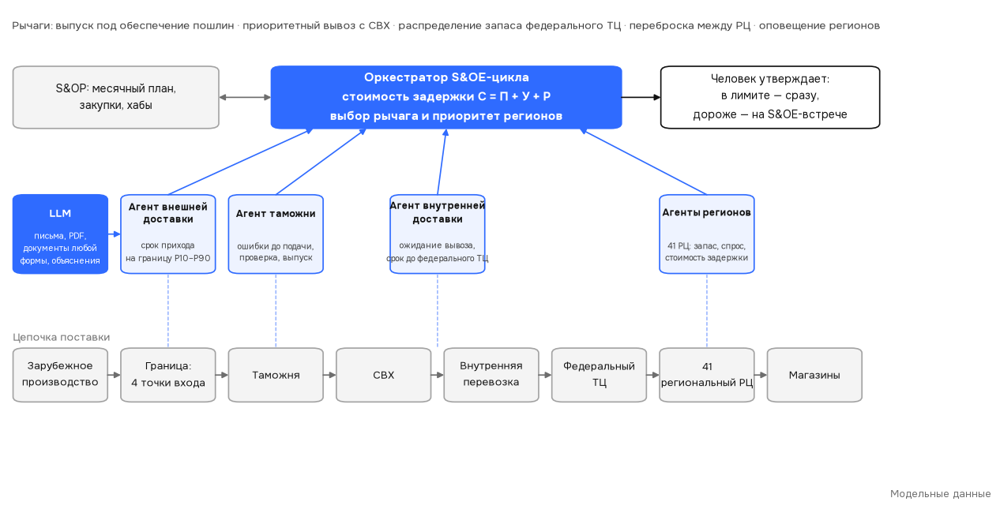
    


<a id="2"></a>
## 2. Модельная сеть: РЦ и точки входа

В сети 41 региональный РЦ. Доля РЦ в спросе равна доле магазинов, для которых он ближайший. Импорт приходит в
федеральный ТЦ; в ближние РЦ товар везут автомобилем, в дальние (дальше 1 500 км, это допущение) — по ж/д.


<div>

<table border="1" class="dataframe">
  <thead>
    <tr style="text-align: right;">
      <th></th>
      <th>Доля спроса</th>
      <th>Доля РЦ, куда везут по ж/д</th>
      <th>Доставка из федерального ТЦ, сут (в среднем)</th>
    </tr>
    <tr>
      <th>Федеральный округ</th>
      <th></th>
      <th></th>
      <th></th>
    </tr>
  </thead>
  <tbody>
    <tr>
      <th>Центральный</th>
      <td>31,0 %</td>
      <td>0 %</td>
      <td>1,3</td>
    </tr>
    <tr>
      <th>Приволжский</th>
      <td>24,9 %</td>
      <td>0 %</td>
      <td>2,7</td>
    </tr>
    <tr>
      <th>Южный</th>
      <td>15,2 %</td>
      <td>0 %</td>
      <td>3,1</td>
    </tr>
    <tr>
      <th>Уральский</th>
      <td>10,4 %</td>
      <td>100 %</td>
      <td>5,5</td>
    </tr>
    <tr>
      <th>Северо-Западный</th>
      <td>9,6 %</td>
      <td>25 %</td>
      <td>2,9</td>
    </tr>
    <tr>
      <th>Сибирский</th>
      <td>5,4 %</td>
      <td>100 %</td>
      <td>8,1</td>
    </tr>
    <tr>
      <th>Северо-Кавказский</th>
      <td>2,3 %</td>
      <td>100 %</td>
      <td>4,8</td>
    </tr>
    <tr>
      <th>Дальневосточный</th>
      <td>1,3 %</td>
      <td>100 %</td>
      <td>14,8</td>
    </tr>
  </tbody>
</table>
</div>


<sub><i>Модельные данные.</i></sub>


    
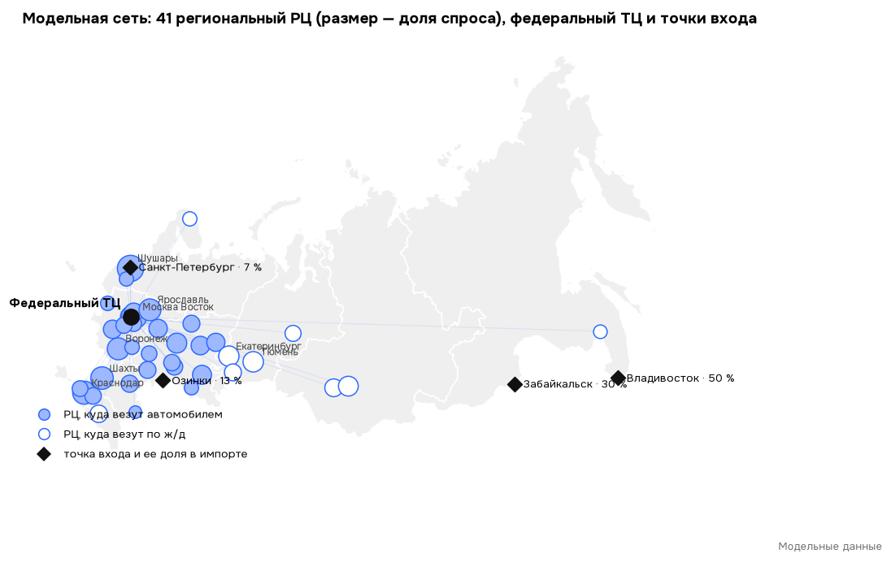
    


    
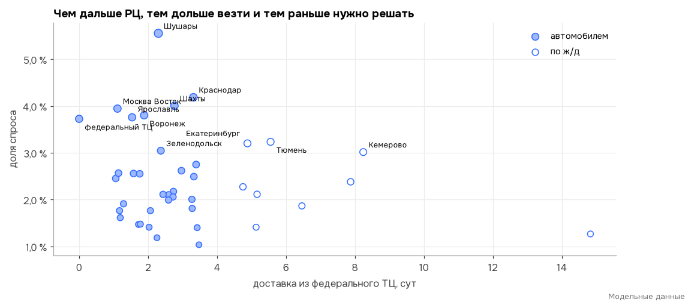
    


<div>

<table border="1" class="dataframe">
  <thead>
    <tr style="text-align: right;">
      <th></th>
      <th>Доля импорта</th>
      <th>Обычное ожидание вывоза с СВХ, сут</th>
      <th>Внутренняя перевозка до федерального ТЦ, сут</th>
    </tr>
    <tr>
      <th>Точка входа</th>
      <th></th>
      <th></th>
      <th></th>
    </tr>
  </thead>
  <tbody>
    <tr>
      <th>Владивосток</th>
      <td>50 %</td>
      <td>8</td>
      <td>13,4</td>
    </tr>
    <tr>
      <th>Забайкальск</th>
      <td>30 %</td>
      <td>10</td>
      <td>10,7</td>
    </tr>
    <tr>
      <th>Озинки</th>
      <td>13 %</td>
      <td>8</td>
      <td>1,9</td>
    </tr>
    <tr>
      <th>Санкт-Петербург</th>
      <td>7 %</td>
      <td>3</td>
      <td>1,4</td>
    </tr>
  </tbody>
</table>
</div>


<sub><i>Модельные данные.</i></sub>


<a id="3"></a>
## 3. Допущения и источники

Все параметры лежат в `config/params.yaml`. У фактов указан источник, у допущений — пометка и диапазон. Денежные
параметры показаны в долях маржи одного контейнера. Ключевые допущения проверены на чувствительность (раздел 10).
Источники по таможне и складам временного хранения (СВХ) — в `docs/sources.md`.


<div>

<table border="1" class="dataframe">
  <thead>
    <tr style="text-align: right;">
      <th></th>
      <th>Значение</th>
      <th>Тип</th>
      <th>Комментарий и источник</th>
    </tr>
    <tr>
      <th>Параметр</th>
      <th></th>
      <th></th>
      <th></th>
    </tr>
  </thead>
  <tbody>
    <tr>
      <th>Маржа</th>
      <td>35 %</td>
      <td>допущение</td>
      <td>доля цены</td>
    </tr>
    <tr>
      <th>Стоимость денег в запасе</th>
      <td>14 % годовых</td>
      <td>источник</td>
      <td>ключевая ставка, нижняя граница</td>
    </tr>
    <tr>
      <th>Запас в пути и на складе</th>
      <td>около 10 дней продаж</td>
      <td>допущение</td>
      <td>контейнеры приходят равномерно, закупка равна ...</td>
    </tr>
    <tr>
      <th>Разброс спроса РЦ относительно плана</th>
      <td>20 %</td>
      <td>допущение</td>
      <td>логнормальный</td>
    </tr>
    <tr>
      <th>Завышение заявок региональными планировщиками</th>
      <td>10 %–20 %</td>
      <td>допущение</td>
      <td>у каждого региона свое; агенты регионов состав...</td>
    </tr>
    <tr>
      <th>Ожидание вывоза с СВХ</th>
      <td>8 / 10 / 8 / 3 сут</td>
      <td>оценка по источнику</td>
      <td>Владивосток, Забайкальск, Озинки — STALOGISTIC...</td>
    </tr>
    <tr>
      <th>Доля деклараций с дополнительной проверкой</th>
      <td>7 %</td>
      <td>оценка по источнику</td>
      <td>доклад ФТС за 2025 год</td>
    </tr>
    <tr>
      <th>Длительность проверки</th>
      <td>5–14 сут</td>
      <td>оценка по источнику</td>
      <td>ТК ЕАЭС, ст. 119</td>
    </tr>
    <tr>
      <th>Доля поставок с ошибкой в документах</th>
      <td>3 %</td>
      <td>оценка по источнику</td>
      <td>ФТС: возвраты деклараций около 1,5 % в день</td>
    </tr>
    <tr>
      <th>Сколько ошибок находит сверка</th>
      <td>80 %</td>
      <td>допущение</td>
      <td></td>
    </tr>
    <tr>
      <th>Новости о задержках в структурированном виде</th>
      <td>40 %</td>
      <td>допущение</td>
      <td>трекинг, EDI, статусы терминалов и РЖД; осталь...</td>
    </tr>
    <tr>
      <th>Документы стандартной формы</th>
      <td>50 %</td>
      <td>допущение</td>
      <td>их сверяют правила; свободные формы и сканы — ...</td>
    </tr>
    <tr>
      <th>Ошибки LLM</th>
      <td>10 %</td>
      <td>допущение</td>
      <td>четверть из них — пропущенная новость (5–20 %)</td>
    </tr>
    <tr>
      <th>Пошлина</th>
      <td>8 %</td>
      <td>допущение</td>
      <td>для условной товарной категории</td>
    </tr>
    <tr>
      <th>НДС на ввоз</th>
      <td>22 %</td>
      <td>источник</td>
      <td>425-ФЗ</td>
    </tr>
    <tr>
      <th>Цена выпуска под обеспечение</th>
      <td>0,11 % маржи контейнера</td>
      <td>оценка по источнику</td>
      <td>банковская гарантия 2 % годовых на 90 дней (ВТ...</td>
    </tr>
    <tr>
      <th>Бесплатное хранение на СВХ</th>
      <td>8 сут</td>
      <td>источник</td>
      <td>тариф ВМТП</td>
    </tr>
    <tr>
      <th>Хранение сверх бесплатного</th>
      <td>0,39 % маржи контейнера в сутки</td>
      <td>источник</td>
      <td>тариф ВМТП</td>
    </tr>
    <tr>
      <th>Цена приоритетного вывоза</th>
      <td>4,0 % маржи контейнера</td>
      <td>допущение</td>
      <td>в тарифах такой услуги нет; диапазон ×0,4 … ×3</td>
    </tr>
    <tr>
      <th>Ожидание при приоритетном вывозе</th>
      <td>2 сут</td>
      <td>оценка по источнику</td>
      <td>STALOGISTIC: отправка «от 2 суток»</td>
    </tr>
    <tr>
      <th>Пересмотр отгрузок / страховой запас РЦ</th>
      <td>каждые 2 дня / 5 дней продаж</td>
      <td>допущение</td>
      <td></td>
    </tr>
    <tr>
      <th>Лимит решения без встречи</th>
      <td>20 % маржи контейнера</td>
      <td>допущение</td>
      <td></td>
    </tr>
    <tr>
      <th>Стоимость работы агентов</th>
      <td>0,11 % прибыли потока</td>
      <td>допущение</td>
      <td>сервер и поддержка; токены LLM — 1 % стоимости</td>
    </tr>
  </tbody>
</table>
</div>


<sub><i>Модельные данные.</i></sub>


<a id="4"></a>
## 4. Как идет контейнер: сроки по этапам

Ниже один вариант режима «загрузка 2026 года». Задержка до границы и ожидание вывоза с СВХ зависят от загрузки
точки входа. Загрузка меняется волнами и держится неделями, поэтому опаздывает не один контейнер, а все, кто приходит
в эти дни. Именно это и позволяет прогнозировать сроки.


    
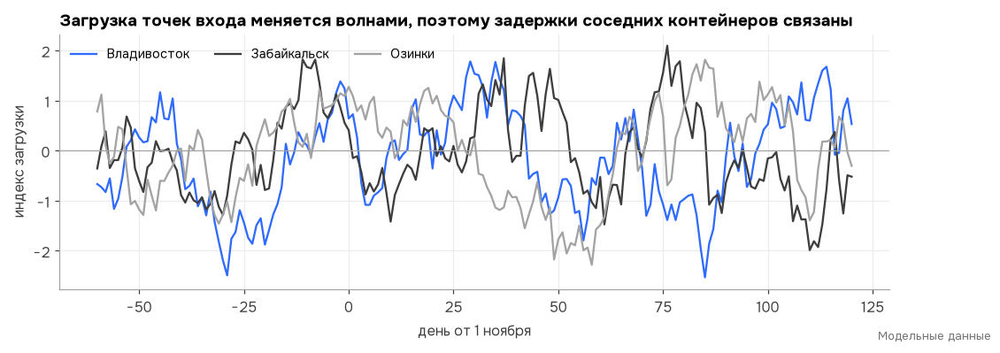
    


    
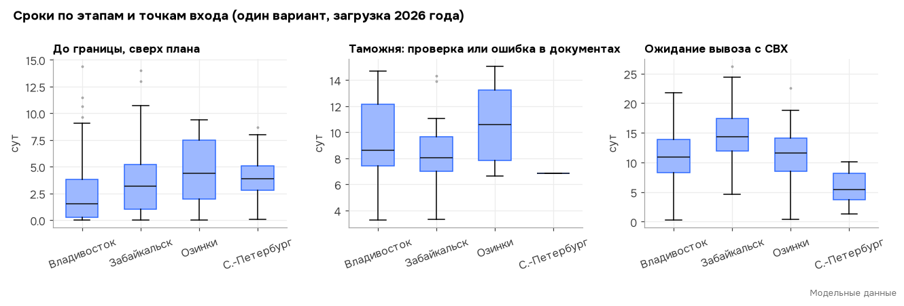
    


Дополнительную проверку таможня назначила 7 % контейнеров, ошибка в документах — у 3,4 %. Обычный выпуск занимает сутки, поэтому на среднем графике только эти контейнеры.


    
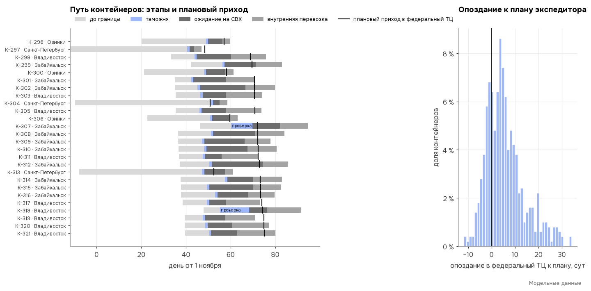
    


На 3 суток и больше опаздывают 60 % контейнеров, на 10 суток и больше — 23 %.


<a id="5"></a>
## 5. ML-агенты сроков: точность и калибровка

Агенты сроков — это квантильная регрессия на градиентном бустинге (scikit-learn). Для каждого контейнера она дает три
оценки: оптимистичную (P10), вероятную (P50) и срок «не позже» (P90). Признаки — точка входа, индекс ее загрузки (в
жизни это данные портов, РЖД и экспедиторов), неделя и задержки оплаты. Модель обучена на синтетической истории трех
прошлых периодов и проверена на новых вариантах, которых не видела.

Если интервал P10–P90 честный, в него попадает около 80 % фактов, а ниже P50 — около половины. Ошибку сравниваем с
тем, чем пользуются планировщики: с планом экспедитора (его ошибка принята за 100 %) и со средним по прошлым периодам.


<div>

<table border="1" class="dataframe">
  <thead>
    <tr style="text-align: right;">
      <th></th>
      <th>Обычный режим</th>
      <th>Загрузка 2026 года</th>
    </tr>
    <tr>
      <th>Калибровка (цель: 80 % и 50 %)</th>
      <th></th>
      <th></th>
    </tr>
  </thead>
  <tbody>
    <tr>
      <th>до границы: в P10–P90</th>
      <td>78 %</td>
      <td>78 %</td>
    </tr>
    <tr>
      <th>до границы: ниже P50</th>
      <td>49 %</td>
      <td>49 %</td>
    </tr>
    <tr>
      <th>СВХ: в P10–P90</th>
      <td>77 %</td>
      <td>33 %</td>
    </tr>
    <tr>
      <th>СВХ: ниже P50</th>
      <td>47 %</td>
      <td>7 %</td>
    </tr>
  </tbody>
</table>
</div>


<sub><i>Модельные данные.</i></sub>


<div>

<table border="1" class="dataframe">
  <thead>
    <tr>
      <th></th>
      <th colspan="2" halign="left">Обычный режим</th>
      <th colspan="2" halign="left">Загрузка 2026 года</th>
    </tr>
    <tr>
      <th></th>
      <th>до границы</th>
      <th>ожидание на СВХ</th>
      <th>до границы</th>
      <th>ожидание на СВХ</th>
    </tr>
    <tr>
      <th>Средняя ошибка, % от ошибки плана</th>
      <th></th>
      <th></th>
      <th></th>
      <th></th>
    </tr>
  </thead>
  <tbody>
    <tr>
      <th>план экспедитора</th>
      <td>100 %</td>
      <td>100 %</td>
      <td>100 %</td>
      <td>100 %</td>
    </tr>
    <tr>
      <th>среднее прошлых периодов</th>
      <td>70 %</td>
      <td>102 %</td>
      <td>70 %</td>
      <td>155 %</td>
    </tr>
    <tr>
      <th>ML-агент (P50)</th>
      <td>52 %</td>
      <td>59 %</td>
      <td>52 %</td>
      <td>125 %</td>
    </tr>
  </tbody>
</table>
</div>


<sub><i>Модельные данные.</i></sub>


    
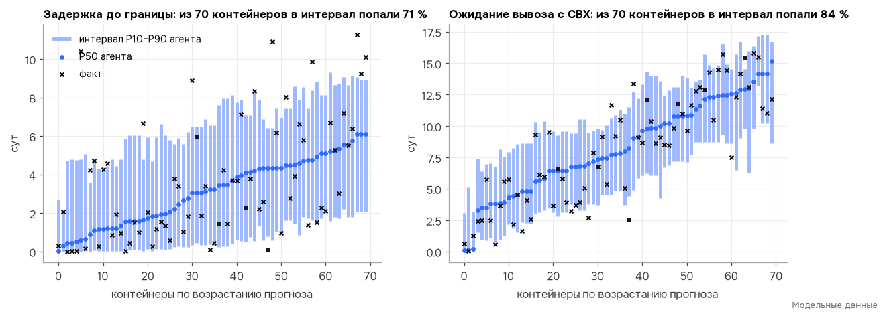
    


**Вывод.** При обычной загрузке интервал честный: в P10–P90 попадают 78 % фактов до границы и 77 % по СВХ. Вероятный срок ошибается на 48 % меньше плана экспедитора до границы и на 41 % меньше по СВХ. При загрузке 2026 года модель, обученная на обычной истории, недооценивает ожидание на СВХ: в интервал попадают только 33 % фактов. Мы ее специально не переобучали, поэтому эффект агентов в этом режиме занижен. В реальной работе модель нужно дообучать на свежих данных.


<a id="6"></a>
## 6. Как это работает на одном варианте

Берем типичный вариант режима «загрузка 2026 года», в котором эффект агентов ближе всего к медиане по 500 вариантам,
и смотрим на него день за днем.

    Вариант 414: с агентами прибыль выше на 4,5 % (медиана по вариантам — 4,5 %)


    
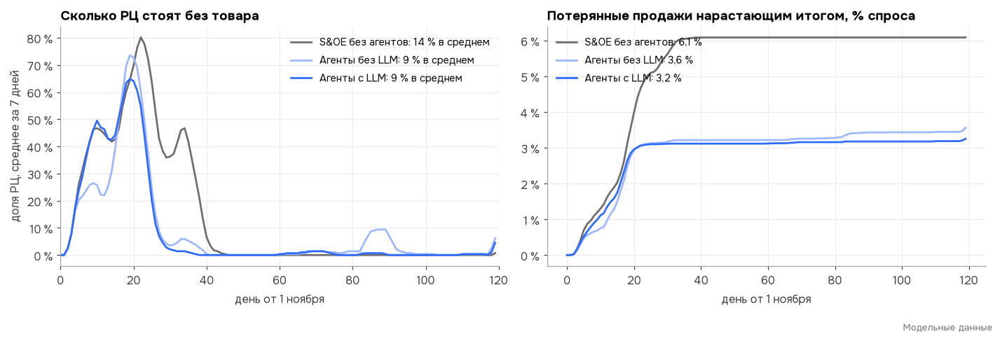
    


    
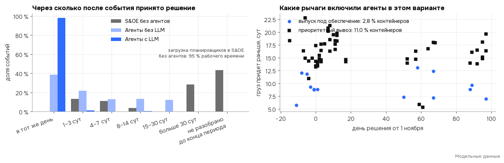
    


    
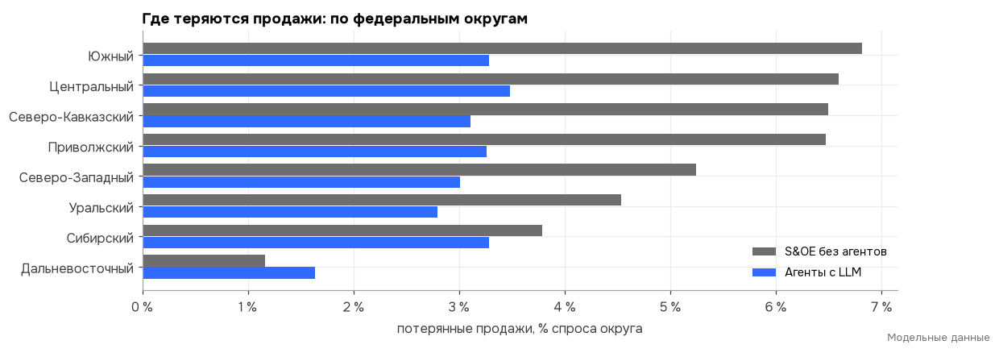
    


**Что видно.** В S&OE без агентов планировщики узнают о задержке из статусов, которые приходят раз в несколько дней и
иногда теряются, и разбирают ее в очереди вместе с обычной работой. Решение приходит через недели, когда рычаг уже не
успевает.

Агенты регионов составляют заявку по прогнозу спроса с учетом продаж, потерянных из-за пустых полок. Агенты без LLM
решают быстро только то, что пришло в структурированном виде, а новости из писем и PDF по-прежнему ждут планировщика.
С LLM агенты читают и их, поэтому почти все события разбираются в тот же день. Продаж теряется меньше во всех
округах.

<a id="7"></a>
## 7. Монте-Карло: результат и его надежность

Для каждого из 500 вариантов считаем, насколько изменилась прибыль при тех же спросе и задержках, но другом управлении.
95-процентный интервал для среднего получен бутстрепом. Стоимость работы агентов вычитается в каждом варианте.


<div>

<table border="1" class="dataframe">
  <thead>
    <tr style="text-align: right;">
      <th>Режим</th>
      <th>Обычный режим</th>
      <th>Загрузка 2026 года</th>
      <th>Сбой</th>
    </tr>
  </thead>
  <tbody>
    <tr>
      <th>Прибыль с агентами выше, чем в S&amp;OE без агентов</th>
      <td>+2,8 %</td>
      <td>+4,7 %</td>
      <td>+2,9 %</td>
    </tr>
    <tr>
      <th>95 % интервал</th>
      <td>+2,7 % … +2,9 %</td>
      <td>+4,5 % … +4,9 %</td>
      <td>+2,8 % … +3,1 %</td>
    </tr>
    <tr>
      <th>Потерянные продажи с агентами</th>
      <td>−35 %</td>
      <td>−33 %</td>
      <td>−24 %</td>
    </tr>
    <tr>
      <th>Доля продаж от спроса с агентами</th>
      <td>+2,0 п. п.</td>
      <td>+3,0 п. п.</td>
      <td>+2,1 п. п.</td>
    </tr>
    <tr>
      <th>Эффект больше стоимости работы агентов</th>
      <td>в 27 раз</td>
      <td>в 41 раз</td>
      <td>в 28 раз</td>
    </tr>
    <tr>
      <th>Доля вариантов, где агенты в плюсе</th>
      <td>98 %</td>
      <td>100 %</td>
      <td>100 %</td>
    </tr>
  </tbody>
</table>
</div>


<sub><i>Модельные данные.</i></sub>


    
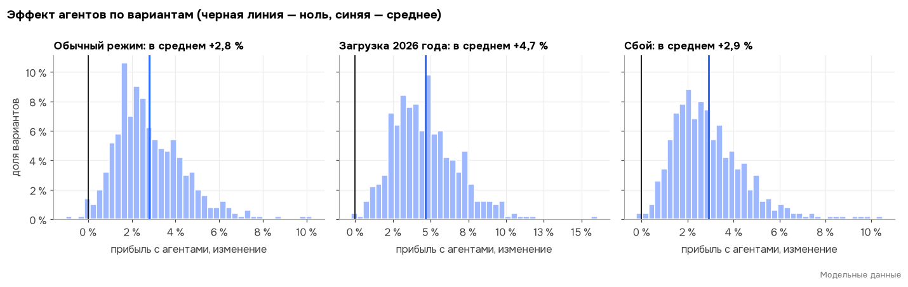
    


    
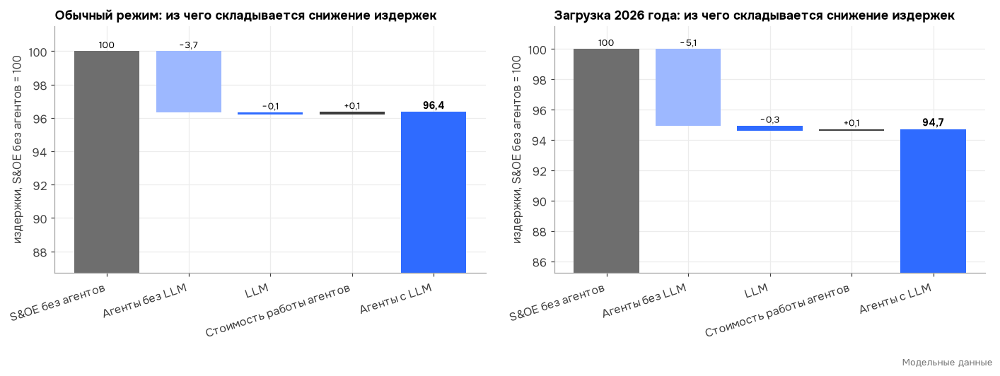
    


    
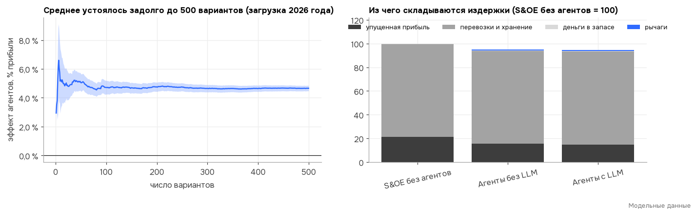
    


### Дело не только в нехватке людей

В S&OE без агентов планировщики загружены почти полностью, поэтому легко возразить: дайте им больше людей, и разница
исчезнет. Мы проверили это на тех же 500 вариантах: дали S&OE без агентов в 10 раз больше планировщиков, чтобы все
статусы и события разбирались в тот же день. Разница между S&OE без агентов при том же штате и
тем же S&OE без очереди — это эффект скорости. Разница между S&OE без очереди и вариантом «Агенты с LLM» — то, чего
людьми не добиться: прогноз сроков, оценка рычага по сценариям,
сверка документов до подачи, оценка потерянных продаж, ни один статус не теряется.


    
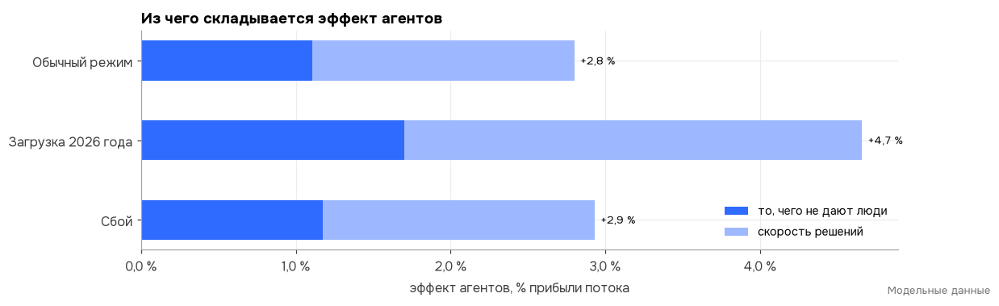
    


<div>

<table border="1" class="dataframe">
  <thead>
    <tr style="text-align: right;">
      <th></th>
      <th>Эффект агентов при том же штате</th>
      <th>из него скорость решений</th>
      <th>Эффект агентов, если планировщиков сколько угодно</th>
      <th>95 % интервал</th>
      <th>Доля вариантов, где агенты в плюсе</th>
    </tr>
    <tr>
      <th>Режим</th>
      <th></th>
      <th></th>
      <th></th>
      <th></th>
      <th></th>
    </tr>
  </thead>
  <tbody>
    <tr>
      <th>Обычный режим</th>
      <td>+2,8 %</td>
      <td>+1,7 %</td>
      <td>+1,1 %</td>
      <td>+1,0 % … +1,2 %</td>
      <td>90 %</td>
    </tr>
    <tr>
      <th>Загрузка 2026 года</th>
      <td>+4,7 %</td>
      <td>+3,0 %</td>
      <td>+1,7 %</td>
      <td>+1,5 % … +1,8 %</td>
      <td>90 %</td>
    </tr>
    <tr>
      <th>Сбой</th>
      <td>+2,9 %</td>
      <td>+1,8 %</td>
      <td>+1,2 %</td>
      <td>+1,1 % … +1,2 %</td>
      <td>91 %</td>
    </tr>
  </tbody>
</table>
</div>


<sub><i>Модельные данные.</i></sub>


<a id="8"></a>
## 8. Как оркестратор решает, включать ли рычаг

У рычага есть цена, например надбавка за приоритетный вывоз, и выгода: товар придет раньше и продаж потеряется
меньше. Выгода зависит от того, когда придут остальные грузы. Если они успеют, ускорять этот контейнер незачем, а если
опоздают, без него регион останется пустым.

**Как было в первом расчете.** Оркестратор брал по каждому грузу один срок, вероятный по прогнозу ML-агентов, и
считал выгоду по нему. Получалось систематически мало: потеря продаж растет быстрее задержки. Если остальные грузы
опоздают, это стоит много, а если придут раньше, экономия маленькая. Средний срок этой асимметрии не видит, поэтому
оркестратор включал рычаги реже, чем нужно. Без ML-прогноза, по плану экспедитора, выходило даже лучше.

**Как стало.** Оркестратор разыгрывает 16 сценариев прихода всех грузов по прогнозу ML-агентов (их интервалам
P10–P90), считает выгоду рычага в каждом и берет среднюю. Рычаг включается, если средняя выгода больше цены.


<div>

<table border="1" class="dataframe">
  <thead>
    <tr style="text-align: right;">
      <th>Режим</th>
      <th>Обычный режим</th>
      <th>Загрузка 2026 года</th>
      <th>Сбой</th>
    </tr>
  </thead>
  <tbody>
    <tr>
      <th>Прибыль выше, чем при оценке по одной точке</th>
      <td>+0,6 %</td>
      <td>+0,7 %</td>
      <td>+0,6 %</td>
    </tr>
    <tr>
      <th>Доля вариантов, где новая оценка лучше</th>
      <td>91 %</td>
      <td>91 %</td>
      <td>93 %</td>
    </tr>
    <tr>
      <th>Приоритетный вывоз: доля контейнеров, одна точка → сценарии</th>
      <td>2,6 % → 4,1 %</td>
      <td>6,0 % → 8,0 %</td>
      <td>2,8 % → 4,3 %</td>
    </tr>
    <tr>
      <th>Выпуск под обеспечение: доля контейнеров, одна точка → сценарии</th>
      <td>0,6 % → 1,4 %</td>
      <td>1,1 % → 2,2 %</td>
      <td>0,6 % → 1,4 %</td>
    </tr>
    <tr>
      <th>Вклад ML-прогноза сроков, % эффекта агентов</th>
      <td>4 %</td>
      <td>4 %</td>
      <td>3 %</td>
    </tr>
  </tbody>
</table>
</div>


<sub><i>Модельные данные.</i></sub>


    
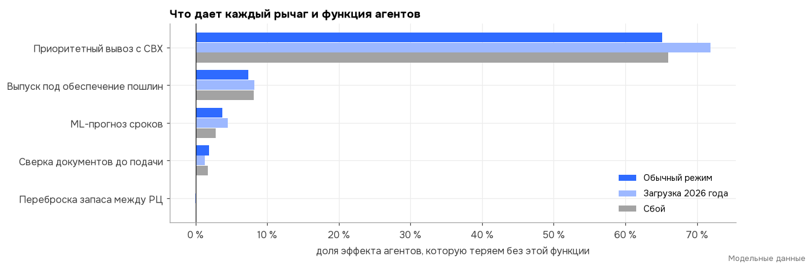
    


<div>

<table border="1" class="dataframe">
  <thead>
    <tr style="text-align: right;">
      <th></th>
      <th>Обычный режим</th>
      <th>Загрузка 2026 года</th>
      <th>Сбой</th>
    </tr>
    <tr>
      <th>Доля контейнеров, где агенты применили рычаг</th>
      <th></th>
      <th></th>
      <th></th>
    </tr>
  </thead>
  <tbody>
    <tr>
      <th>выпуск под обеспечение</th>
      <td>1,4 %</td>
      <td>2,2 %</td>
      <td>1,4 %</td>
    </tr>
    <tr>
      <th>приоритетный вывоз</th>
      <td>4,1 %</td>
      <td>8,0 %</td>
      <td>4,3 %</td>
    </tr>
    <tr>
      <th>переброска между РЦ</th>
      <td>0,0 %</td>
      <td>0,0 %</td>
      <td>0,0 %</td>
    </tr>
    <tr>
      <th>ошибка в документах найдена до подачи</th>
      <td>2,4 %</td>
      <td>2,4 %</td>
      <td>2,4 %</td>
    </tr>
  </tbody>
</table>
</div>


<sub><i>Модельные данные.</i></sub>


**Как читать.** Вклад показывает, какую долю эффекта агентов мы теряем, если убрать только эту функцию. Сумма вкладов не равна 100 %, потому что функции дополняют друг друга. В обычном режиме больше всего дает приоритетный вывоз с СВХ: 65 % эффекта. Агенты включают его у 4,1 % контейнеров, когда товар нужен срочно, а очередь на терминале длинная. Его цена (4,0 % маржи контейнера) — наше допущение, потому что в публичных тарифах такой услуги нет; это первое, что стоит проверить в пилоте. Выпуск под обеспечение стоит 0,11 % маржи контейнера и снимает всю дополнительную проверку. Нужен он редко (у 1,4 % контейнеров), но каждый раз окупается многократно. ML-прогноз сроков теперь работает в плюс (4 % эффекта): сценарии для оценки рычага строятся по его интервалам. Переброска между РЦ почти не нужна, потому что общий запас в федеральном ТЦ делает ее лишней.


<a id="9"></a>
## 9. Где нужна LLM

LLM в схеме ничего не считает: все числа дают ML-агенты и расчеты оркестратора. Она нужна там, где
правила бессильны.

1. **Письма, PDF, сообщения и поток статусов.** Экспедиторы и брокеры сообщают о задержках письмами, сканами и в
   мессенджерах. Мы приняли, что в структурированном виде (трекинг, EDI, статусы терминалов и РЖД) приходит только
   40 % новостей. Без LLM остальные ждут планировщика, а сам поток статусов планировщики читают
   вручную и на разбор отклонений у них остается меньше времени.
2. **Документы любой формы.** Правила сверяют инвойс, упаковочный лист и декларацию только в стандартной форме, а это
   около 50 % комплектов. LLM читает и свободные формы поставщиков, и сканы, поэтому находит больше
   ошибок до подачи декларации.
3. **Объяснение и переписка.** LLM пишет человеку, почему предложен этот рычаг, и готовит письма брокеру и
   экспедитору. В деньгах мы это не считаем, но без этого решение агента трудно утвердить.

Ошибки LLM учтены: часть новостей она пропускает, и они идут к людям.


Функции дополняют друг друга, поэтому их вклады по отдельности в сумме меньше общего.


<div>

<table border="1" class="dataframe">
  <thead>
    <tr style="text-align: right;">
      <th>Режим</th>
      <th>Обычный режим</th>
      <th>Загрузка 2026 года</th>
      <th>Сбой</th>
      <th>Сезонный, впритык</th>
    </tr>
  </thead>
  <tbody>
    <tr>
      <th>Доля эффекта агентов, которую дает LLM</th>
      <td>3 %</td>
      <td>6 %</td>
      <td>4 %</td>
      <td>38 %</td>
    </tr>
    <tr>
      <th>Издержки с LLM, изменение</th>
      <td>−0,12 %</td>
      <td>−0,36 %</td>
      <td>−0,14 %</td>
      <td>−4,38 %</td>
    </tr>
    <tr>
      <th>Доля вариантов, где LLM дает плюс</th>
      <td>59 %</td>
      <td>65 %</td>
      <td>62 %</td>
      <td>99 %</td>
    </tr>
    <tr>
      <th>в том числе письма и поток статусов</th>
      <td>1 %</td>
      <td>2 %</td>
      <td>1 %</td>
      <td>37 %</td>
    </tr>
    <tr>
      <th>в том числе документы любой формы</th>
      <td>1 %</td>
      <td>1 %</td>
      <td>1 %</td>
      <td>1 %</td>
    </tr>
  </tbody>
</table>
</div>


<sub><i>Модельные данные.</i></sub>


    
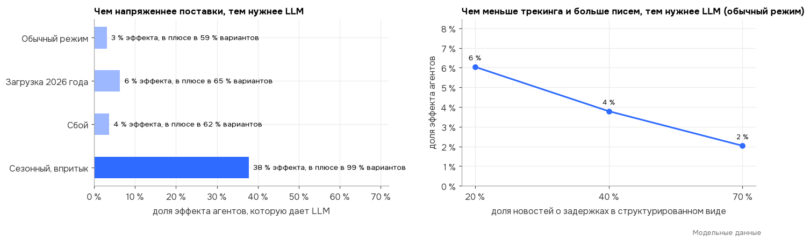
    


**Вывод.** Главный денежный эффект дают расчеты агентов: прогноз сроков и выбор рычагов. LLM открывает им ту
часть информации, которая приходит не в таблицах, а в тексте, и снимает с планировщиков чтение потока писем. В спокойном
потоке это небольшая добавка, потому что планировщики успевают разобрать письма сами. Когда поставки впритык и каждый
день задержки стоит дорого, вклад LLM заметно растет. Чем меньше у компании трекинга и электронного обмена с
экспедиторами и брокерами, тем нужнее LLM. Еще одна функция в модели не учтена: LLM может готовить ответ на запрос
документов от таможни в тот же день. Это стоит проверить в пилоте.

<a id="10"></a>
## 10. Когда агенты нужнее всего

Обычный режим, 200 вариантов на каждую точку. Меняем одно допущение, остальные оставляем базовыми. Эффект
показан в процентах прибыли потока при базовых допущениях, значения допущений — относительно базы.


    
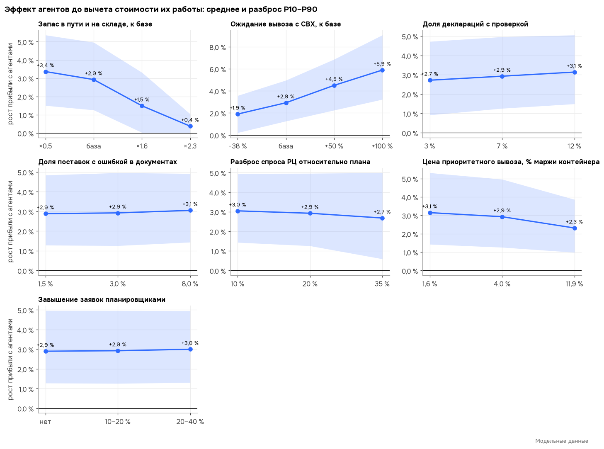
    


    
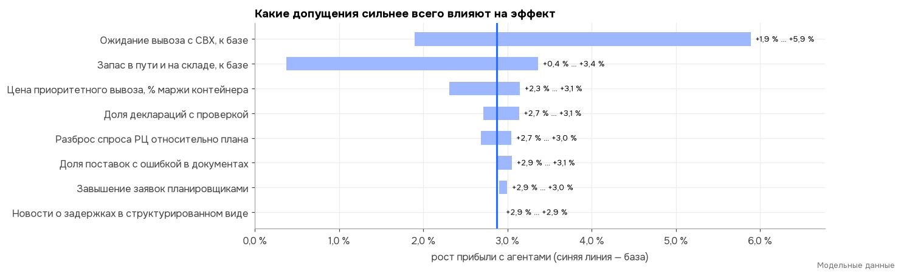
    


**Вывод.** Сильнее всего на эффект влияют загрузка терминалов и запас в пути. Завышение заявок планировщиками эффект
почти не меняет: выигрыш агентов дают скорость решений и рычаги, а не точность заявок. Чем дольше груз ждет вывоза, тем
ценнее ранний прогноз и приоритетный вывоз. Большой запас сам гасит задержки, и агенты почти ничего не меняют.
Бережливый поток без агентов теряет продажи на каждой задержке. Даже если приоритетный вывоз стоит втрое дороже
базового допущения, эффект сохраняется: агенты просто включают его реже.

<a id="11"></a>
## 11. Проверки модели

Автотесты лежат в `tests/test_v5.py`.


<div>

<table border="1" class="dataframe">
  <thead>
    <tr style="text-align: right;">
      <th></th>
      <th>Выполнена</th>
    </tr>
    <tr>
      <th>Проверка</th>
      <th></th>
    </tr>
  </thead>
  <tbody>
    <tr>
      <th>Баланс штук: пришло = продано + остаток + в пути, во всех вариантах</th>
      <td>да</td>
    </tr>
    <tr>
      <th>Одинаковый спрос у всех способов управления в одном варианте</th>
      <td>да</td>
    </tr>
    <tr>
      <th>ML-сроки: в интервал P10–P90 попадает 75–85 % прибытий (обычный режим)</th>
      <td>да</td>
    </tr>
    <tr>
      <th>Заявки завышают только планировщики; агенты регионов составляют заявку по прогнозу</th>
      <td>да</td>
    </tr>
    <tr>
      <th>Цена рычагов входит в издержки; с агентами издержки не выше</th>
      <td>да</td>
    </tr>
    <tr>
      <th>Рычаг не знает будущего: о проверке таможни известно только после подачи декларации</th>
      <td>да</td>
    </tr>
  </tbody>
</table>
</div>


<sub><i>Модельные данные.</i></sub>


**Оптимизатор или простое правило.** Мы проверили, не лучше ли распределять запас федерального ТЦ линейной задачей на 21 день вперед (HiGHS). Оказалось хуже простого правила «запас на срок доставки плюс страховой»: издержки выше на 4,4 % (обычный режим); 4,8 % (загрузка 2026 года); 3,8 % (сбой). При точности прогноза спроса, заложенной в модель, сложная оптимизация не окупается, поэтому запас распределяется по правилу, а оркестратор решает, какие грузы ускорять.


<a id="12"></a>
## 12. Пример: разбор одного контейнера агентами

Запись разбора с LLM на модельных данных (`agents/recordings/K-382.json`): запросы к LLM настоящие, а контейнер K-382 и
его данные взяты из модели. В модели K-382 стоит на дополнительной проверке в Забайкальске, а в нескольких РЦ товар
кончается на этой неделе. Каждый агент вызывает расчеты модели и
пишет вывод. Числа в тексте сверяются с результатами расчетов: если LLM написала число, которого нет в
расчете, вместо ее текста показывается текст правила.


<div>

<table border="1" class="dataframe">
  <thead>
    <tr style="text-align: right;">
      <th></th>
      <th>Что выяснил</th>
      <th>Расчеты</th>
      <th>Кто написал вывод</th>
      <th>Числа сверены</th>
    </tr>
    <tr>
      <th>Агент</th>
      <th></th>
      <th></th>
      <th></th>
      <th></th>
    </tr>
  </thead>
  <tbody>
    <tr>
      <th>Агент внешней доставки</th>
      <td>срок прихода на границу и опоздание к плану</td>
      <td>get_tracking</td>
      <td>LLM</td>
      <td>все</td>
    </tr>
    <tr>
      <th>Агент таможни</th>
      <td>сверка документов, статус проверки, выпуск под...</td>
      <td>check_documents, customs_status</td>
      <td>правило (LLM написала число не из расчета)</td>
      <td>все</td>
    </tr>
    <tr>
      <th>Агент внутренней доставки</th>
      <td>ожидание вывоза с СВХ, срок до федерального ТЦ...</td>
      <td>svh_status, rail_eta</td>
      <td>правило (LLM написала число не из расчета)</td>
      <td>все</td>
    </tr>
    <tr>
      <th>Агенты регионов</th>
      <td>в каких РЦ товар кончится раньше всего и во чт...</td>
      <td>top_regions</td>
      <td>LLM</td>
      <td>все</td>
    </tr>
    <tr>
      <th>Оркестратор S&amp;OE-цикла</th>
      <td>выбор рычага, порядок регионов, карточка решения</td>
      <td>evaluate_levers, allocation_plan, create_decision</td>
      <td>LLM</td>
      <td>все</td>
    </tr>
  </tbody>
</table>
</div>


<sub><i>Модельные данные.</i></sub>


    
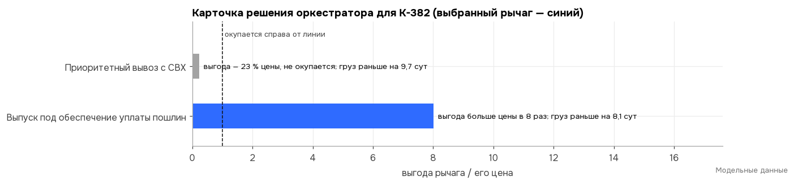
    


**Решение:** «Выпуск под обеспечение уплаты пошлин». Выгода больше цены в 8 раз, груз придет на 8,1 сут раньше. Товар сначала уходит в РЦ: Краснодар, Тюмень, Москва Восток, Ярославль. Решение утверждает человек: в пределах лимита сразу, дороже лимита — на S&OE-встрече.


<a id="13"></a>
## 13. Приложение: сезонный товар

Для сравнения — сезонный товар с пиком продаж в декабре. Его закупают с запасом на весь сезон, а остаток после сезона
уценивают. Большой запас сам гасит задержки, поэтому агенты почти не нужны, пока товар не начинает приходить впритык
к продажам.


Издержки показаны индексом: S&OE без агентов = 100.


<div>

<table border="1" class="dataframe">
  <thead>
    <tr style="text-align: right;">
      <th>Режим</th>
      <th>Сезонный товар</th>
      <th>Сезонный, впритык</th>
    </tr>
  </thead>
  <tbody>
    <tr>
      <th>Издержки: S&amp;OE без агентов</th>
      <td>100,0</td>
      <td>100,0</td>
    </tr>
    <tr>
      <th>Издержки: Агенты без LLM</th>
      <td>100,0</td>
      <td>93,2</td>
    </tr>
    <tr>
      <th>Издержки: Агенты с LLM</th>
      <td>100,0</td>
      <td>89,0</td>
    </tr>
    <tr>
      <th>Издержки: Агенты с LLM, изменение после стоимости работы агентов</th>
      <td>+0,0 %</td>
      <td>−10,9 %</td>
    </tr>
    <tr>
      <th>Потерянные продажи: Агенты с LLM, изменение</th>
      <td>−37 %</td>
      <td>−30 %</td>
    </tr>
  </tbody>
</table>
</div>


<sub><i>Модельные данные.</i></sub>


<a id="14"></a>
## 14. Ограничения и что нужно для пилота

**Ограничения**

- Все данные модельные. Спрос, сроки, ошибки в документах, проверки и экономика синтетические, параметры взяты из
  открытых источников или заданы допущениями с диапазоном. Результат показывает механизм и порядок эффекта, но не
  прогнозирует его для реальной компании.
- Контейнер однородный: одна условная товарная категория, без смешанных контейнеров и приоритета артикулов.
- ML-агенты обучены на истории обычной загрузки и не переобучались под режим 2026 года.
- Цена приоритетного вывоза с СВХ и доля информации в структурированном виде — допущения. Оба проверены на
  чувствительность, но в пилоте их нужно измерить.
- Оценку рычага по сценариям мы добавили после первого расчета, когда увидели, что оценка по одной точке занижает
  выгоду. Оба варианта есть в результатах (раздел 8).
- Схема «весь импорт через федеральный ТЦ» — допущение модели. Где ставить хабы, решается в S&OP, здесь это не считается.

**Что нужно для пилота (8–10 недель, одна точка входа)**

1. Выгрузки за год: статусы контейнеров от экспедитора, даты выпуска деклараций и запросов документов, продажи и
   остатки РЦ по дням. На них обучаются агенты сроков.
2. Сколько статусов приходит в структурированном виде, а сколько письмами. От этого зависит вклад LLM.
3. Договоренность с терминалами о приоритетном вывозе и его цене: это главный по эффекту рычаг.
4. Договор с банком о гарантиях в пользу таможни и порядок их выдачи по запросу: это самый дешевый рычаг.
5. Сравнение до и после на одной точке входа: опоздание к плану, доля дней без товара в РЦ, потерянные продажи. Это
   те же показатели, что в модели.

**Как воспроизвести**

```bash
python3 -m venv .venv && .venv/bin/pip install -r requirements.txt nbformat nbconvert ipykernel
.venv/bin/python -m src.v5.experiments                 # results.json и runs.csv
.venv/bin/python -m src.v5.experiments --staff-check   # runs_staff.csv
.venv/bin/python -m analysis.build                     # этот отчет: report.ipynb и REPORT.md
```

*Все данные в отчете модельные.*
